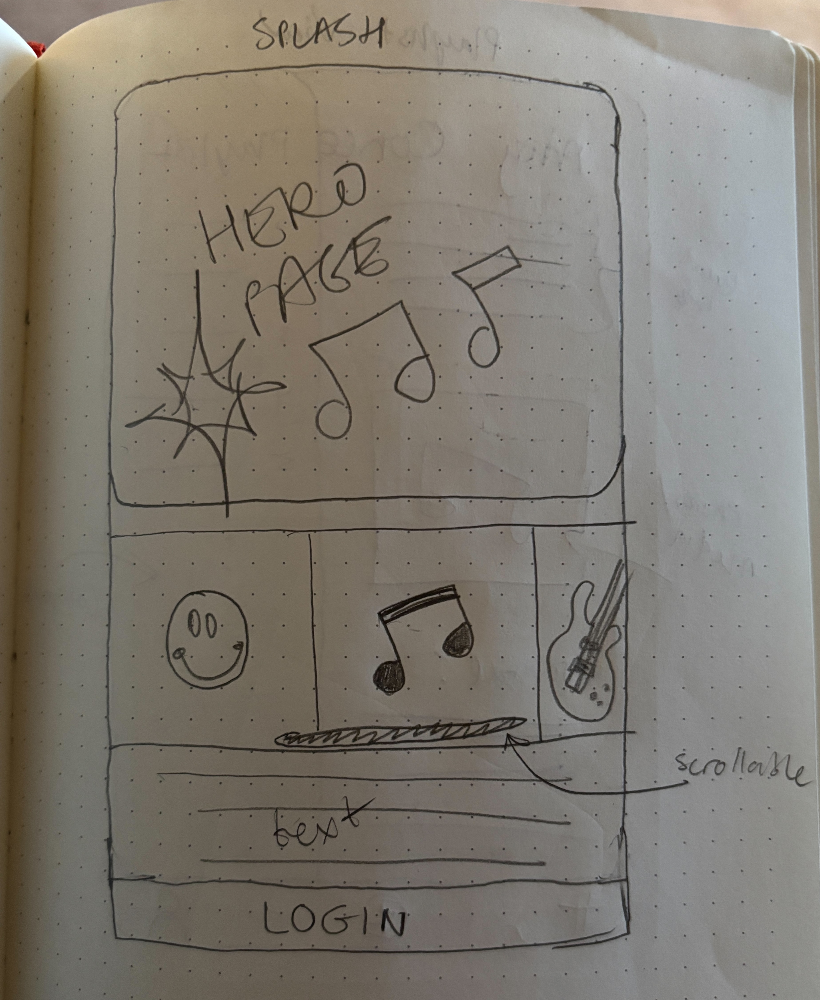
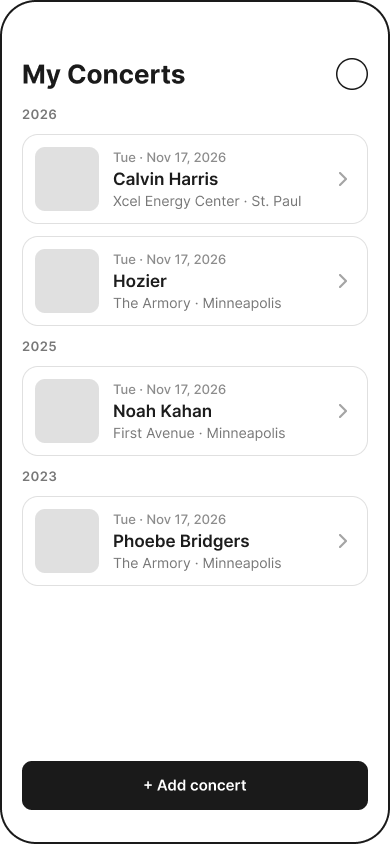
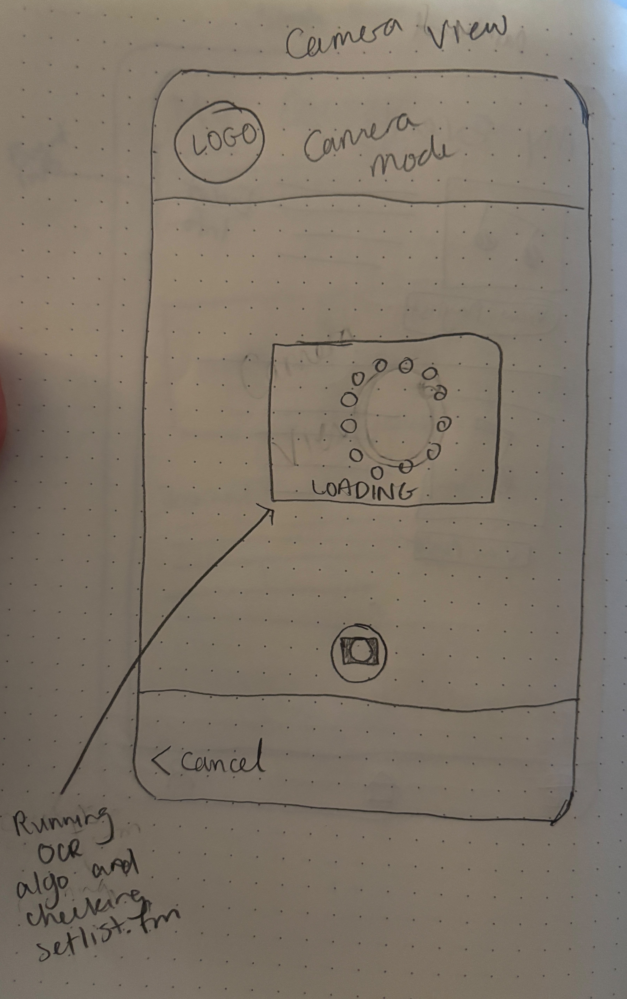
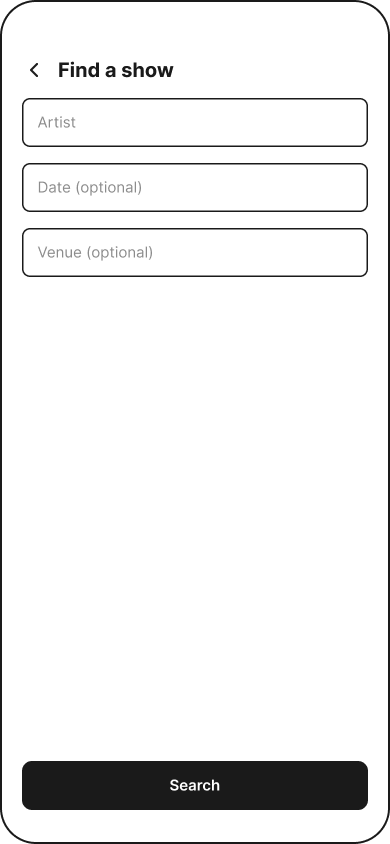
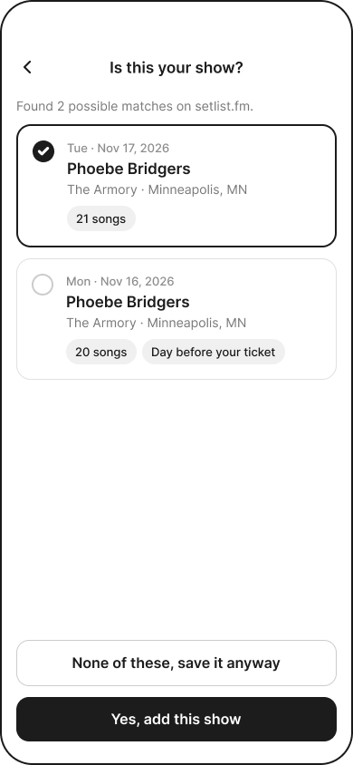
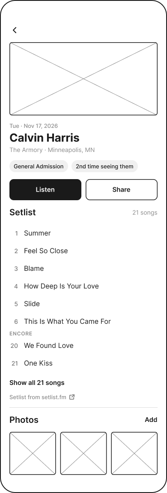

# Module 2 Group Assignment

CSCI 5117, Fall 2026, [assignment description](https://canvas.umn.edu/courses/579310/pages/project-2)

## App Info:

* Team Name: Yarakani
* App Name: TODO
* App Link: <https://TODO.com/>

### Students

* Ray Amberg, amber079@umn.edu
* Blake Gabriel, gabri354@umn.edu

## Key Features

**Describe the most challenging features you implemented
(one sentence per bullet, maximum 4 bullets):**

* ...

Which (if any) device integration(s) does your app support?

* ...

Which (if any) progressive web app feature(s) does your app support?

* ...

## Mockup images

**[Add images/photos that show your mockup](https://stackoverflow.com/questions/10189356/how-to-add-screenshot-to-readmes-in-github-repository) along with a very brief caption:**

### 1. Splash screen

*Splash screen shown when the app opens*

### 2. Home

*Main page showing all of the user's concert entries*

### 3. Scan ticket

*Screen with camera passthrough where the user will take a photo of their ticket and the app extracts the concert information from it*

### 4. Search

*Search page where the user can manually input concert info*

### 5. Confirm show

*After scanning, the app suggests which concert the ticket might be for and the user confirms the correct one*

### 6. Concert page

*Page where all concert information exists. Includes images the user has uploaded, concert info, setlist extracted from setlist.fm, etc.*

## Testing Notes

**Is there anything special we need to know in order to effectively test your app? (optional):**

* ...

## Screenshots of Site (complete)

**[Add a screenshot of each key page](https://stackoverflow.com/questions/10189356/how-to-add-screenshot-to-readmes-in-github-repository)
along with a very brief caption:**

## External Dependencies

**Document integrations with 3rd Party code or services here.
Please do not document required libraries (e.g., VUE, Firebase, vuefire).**

* Library or service name: description of use
* ...

**If there's anything else you would like to disclose about how your project
relied on external code, expertise, or anything else, please disclose that
here:**

...
